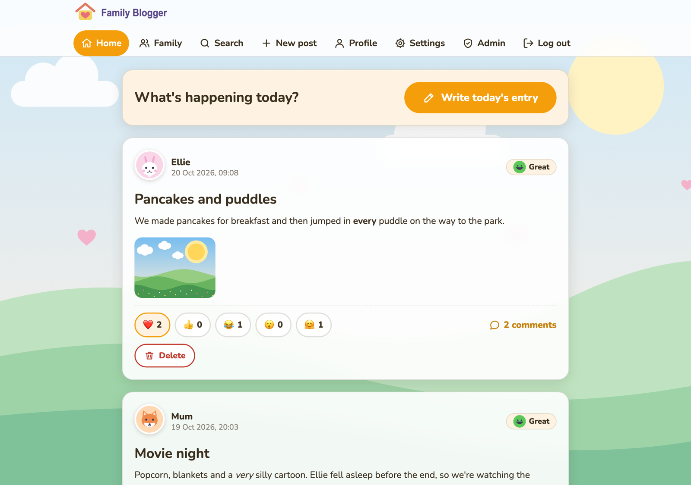
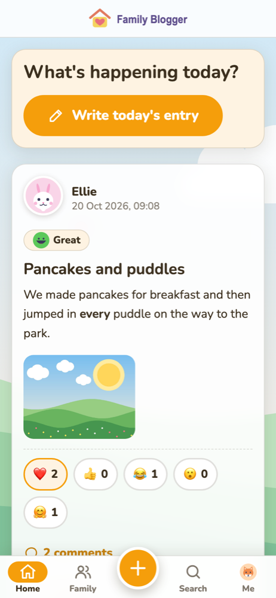
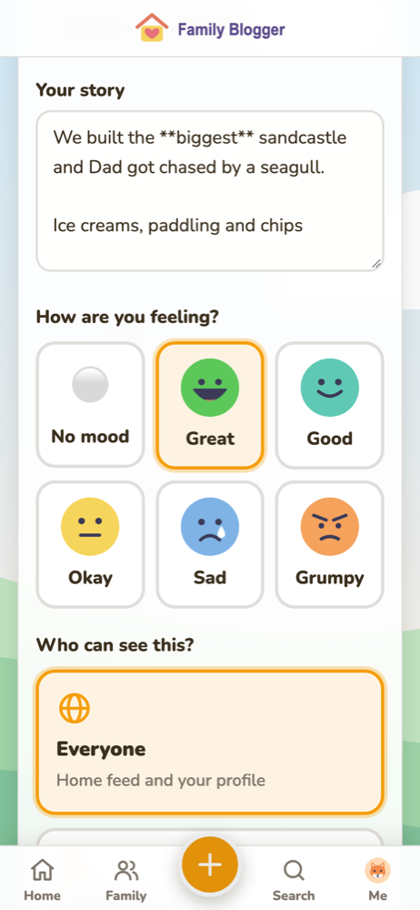
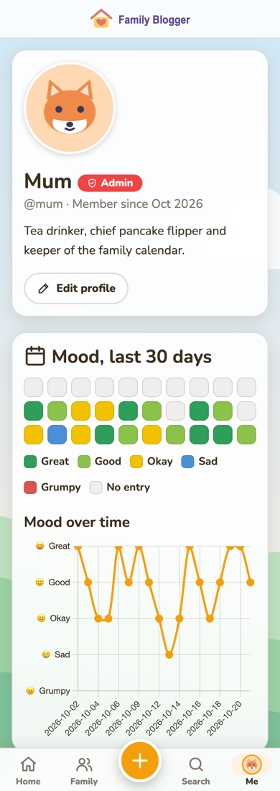

<p align="center">
  
</p>

<p align="center"><strong>A cosy, private diary and blog for your family, running on your own home network.</strong></p>

---

Family Blogger isn't trying to copy any social media platform. It's a calm little place where a family can share their days: a gentle first taste of social media for children, kept safe on your own network and watched over by parents. Children can write about their day, keep personal or private entries, and the whole family builds up a store of precious memories.

Most entries are a **daily diary**: how you're feeling and what you got up to today.

<p align="center">
  
</p>

<p align="center">
  
  
  
</p>

## What it does

- 📔 **Daily diary with moods.** Pick a mood (Great, Good, Okay, Sad or Grumpy), give the entry a title, and write about your day with simple formatting. Add photos straight from your phone's camera or gallery.
- 👀 **You choose who sees each post:**
  - **Everyone** — shown on the family home feed and your profile.
  - **Profile** — only on your profile, where the family can still read it.
  - **Private** — only you (and the family admin) can see it.
- 📅 **Mood history.** Every profile has a 30-day mood calendar and a chart of moods over time.
- 💬 **Comments and kind reactions.** Reply to each other and react with ❤️ 👍 😂 😮 🤗.
- 🔍 **Search.** Find old entries by words, person, mood or date.
- 🎨 **Make it yours.** Pick a colour theme or choose your own colours, upload a background, and choose an animal avatar or your own picture.
- 📱 **Phone friendly.** It's designed for phones and tablets, and you can add it to your home screen so it opens like an app.
- 👨‍👩‍👧 **Parents stay in charge:**
  - The first person to sign up becomes the admin.
  - Admins can reset passwords, make other people admins, and remove posts or accounts.
  - There are no email addresses: just a username and password.

## Privacy by design

- **Your data stays home.** Everything lives in one folder on your server. There are no ads, no tracking, no analytics and no third-party accounts.
- **Calm, not compulsive.** The feed is in date order, with no follower counts, popularity rankings, algorithm or endless scroll.
- **Family only.** There are no public profiles and no way for strangers to find anyone.

## Install with Docker

You'll need a Linux server (or any machine) with [Docker](https://docs.docker.com/engine/install/) and Docker Compose. There's a ready-made image at `ghcr.io/timj425/family-blogger`, so you don't need the source code:

```bash
mkdir family-blogger && cd family-blogger
mkdir -p data              # where the database and photos are stored
curl -fsSL -o compose.yaml https://raw.githubusercontent.com/TimJ425/family-blogger/main/deploy/compose.ghcr.yaml
curl -fsSL -o .env https://raw.githubusercontent.com/TimJ425/family-blogger/main/deploy/.env.example
curl -fsSL -o backup.sh https://raw.githubusercontent.com/TimJ425/family-blogger/main/deploy/backup.sh && chmod +x backup.sh
docker compose up -d
```

The folder then only holds `compose.yaml`, `.env`, `backup.sh` and `data/`.

<details>
<summary>Prefer to build the image yourself?</summary>

```bash
git clone https://github.com/TimJ425/family-blogger.git
cd family-blogger/deploy
mkdir -p data
cp .env.example .env
docker compose up -d --build
```

</details>

Check it's running with `docker compose ps`. The status should change to **healthy** within a few seconds.

Then open **`http://<server-ip>:8765`**. **The first account you create becomes the admin**, so sign up yourself before sharing the link with the family.

### Settings (`.env`)

| Setting | Default | What it does |
|---|---|---|
| `PUID` / `PGID` | `1000` | The user the app runs as. These must match the owner of the `data/` folder; check yours with `id -u` and `id -g`. |
| `FB_PORT` | `8765` | The port on your server. |
| `TZ` | `Europe/London` | Your timezone, which decides which day a diary entry belongs to. |
| `FB_TAG` | `latest` | The image version. Use `latest` for the newest build, or pin a release such as `1.0` or `1.0.2`. |

After changing `.env`, run `docker compose up -d` to apply it.

### Using your own domain and HTTPS

You can put Family Blogger behind a reverse proxy such as **Nginx Proxy Manager**, Caddy or Traefik. Point the proxy at `http://<server-ip>:8765`. The app already understands the proxy's forwarded headers, so links and redirects keep working over `https://`.

In Nginx Proxy Manager, add a **Proxy Host** like this:

- **Domain:** your domain, for example `family.example.com`
- **Scheme:** `http`
- **Forward IP:** your server
- **Forward port:** `8765`
- **SSL tab:** a Let's Encrypt certificate, with **Force SSL** on

Direct access at `http://<server-ip>:8765` keeps working alongside the domain.

### Updating

```bash
cd family-blogger
docker compose pull
docker compose up -d
```

Your data in `data/` is kept. If you built the image yourself, run `git pull` and then `docker compose up -d --build` from `deploy/`.

### Backups

`data/` holds everything: the database, the uploaded photos and the sign-in secret key. To make a backup while the app is running:

```bash
cd family-blogger
./backup.sh                # saves backups/family-blogger_<date>.tar.gz
./backup.sh /mnt/nas       # or save it to another folder
```

To back up automatically every night at 3am, add this line with `crontab -e`:

```
0 3 * * * cd /path/to/family-blogger && ./backup.sh >> backup.log 2>&1
```

**To restore:**

1. Stop the app with `docker compose down`.
2. Unpack the backup and copy its files into `data/`.
3. Start it again with `docker compose up -d`.

### Handy commands

Run these from the `family-blogger` folder:

```bash
docker compose logs -f     # watch what's happening
docker compose restart     # restart the app
docker compose down        # stop it
```

## Keeping it safe

Family Blogger is meant for **a family on a trusted network**.

- **Anyone who can reach the site can create an account.** Keep it on your home network or VPN. If your domain can be reached from the internet, add an IP allow-list or a password prompt in front of it, for example an Access List in Nginx Proxy Manager.
- **There's no email password recovery.** If someone forgets their password, an admin resets it from the **Admin** page.

## Contributing

Ideas and improvements are welcome. Please read [CONTRIBUTING.md](CONTRIBUTING.md) first. It covers running the app locally, the tests, the coding rules and the principles that keep Family Blogger calm, private and family-first.

## Licence

Copyright © 2026 Family Blogger contributors.

Family Blogger is free software under the [GNU Affero General Public License v3.0](LICENCE.md). You can use, change and self-host it freely. If you share a modified version, including running it as a service for other people, you must make your changes available under the same licence.
